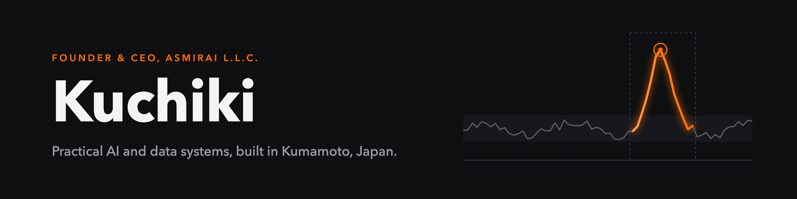
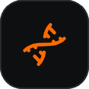

   
  
  
  

## Data & ML

<table>
  <tr>
    <td width="50%" valign="top">
      <h3><a href="https://github.com/Asmirai/edinet-ma-ledger">M&A Ledger of Japanese Listed Companies</a></h3>
      
A ledger of 6,324 acquisitions extracted from annual securities reports with Claude, and a model that predicts goodwill impairment within three years. <a href="https://asmirai.github.io/edinet-ma-ledger/">Simulator</a> · <a href="https://qiita.com/ykuchiki/items/18d31329d81581d56a61">Article</a>

      
  

    </td>
    <td width="50%" valign="top">
      <h3><a href="https://github.com/ykuchiki/HolmesVAU">HolmesVAU for macOS</a></h3>
      
Runs inference of HolmesVAU, a video anomaly understanding model, on Apple Silicon Macs.

      
  

    </td>
  </tr>
  <tr>
    <td width="50%" valign="top">
      <h3><a href="https://github.com/ykuchiki/mugicha">Suika-Style Puzzle Agent</a></h3>
      
Trains a deep Q-network to play decopon, a Suika Game–style fruit-merging puzzle.

      
   

    </td>
    <td width="50%" valign="top">
      <h3><a href="https://github.com/ykuchiki/shift_maker">Shift Maker</a></h3>
      
Generates staff shift schedules automatically with a genetic algorithm.

      
  

    </td>
  </tr>
</table>

## Tools & Simulations

<table>
  <tr>
    <td width="50%" valign="top">
      <h3><a href="https://github.com/ykuchiki/gmail-mcp">Gmail MCP</a></h3>
      
An MCP server that lets AI assistants send, read and search Gmail, and manage labels and filters.

      
   

    </td>
    <td width="50%" valign="top">
      <h3><a href="https://github.com/ykuchiki/todo-to-google-calendar">Todo Sync for Obsidian</a></h3>
      
An Obsidian plugin that syncs monthly Todo notes with Google Calendar.

      
   

    </td>
  </tr>
  <tr>
    <td width="50%" valign="top">
      <h3><a href="https://github.com/ykuchiki/generative_agents_for_accident">Generative Agents in a Fire</a></h3>
      
Adds a fire to the Generative Agents town to see how agents with different personalities respond.

      
  

    </td>
    <td width="50%" valign="top">
      <h3><a href="https://github.com/ykuchiki/FireEscape_plugin_Minecraft_spigot">Fire Escape for Minecraft</a></h3>
      
A Spigot plugin that scans a building, starts a fire and simulates villagers evacuating.

      
  

    </td>
  </tr>
</table>

[All repositories](https://github.com/ykuchiki?tab=repositories) · [asmirai.net](https://asmirai.net/)

